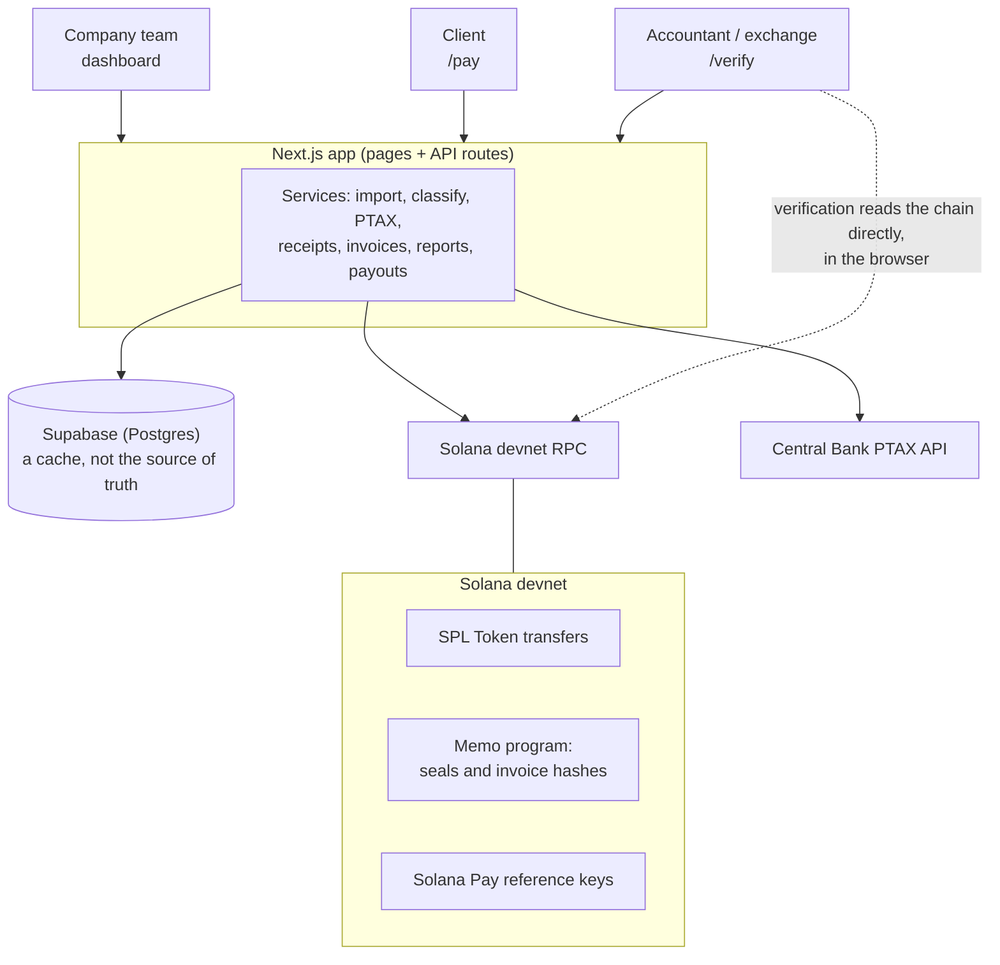

# Yvex Chain

**Stablecoin receivables for Brazilian companies, with proof.**

Brazilian software houses, agencies and freelancers increasingly sell services abroad and get
paid in stablecoins. The money arrives in seconds, but a wallet only shows anonymous
transfers: no client, no invoice, no value in reais. And since 2026 the paperwork is theirs:
whoever converts those stablecoins to reais has to be told who paid, for what, and why.

Yvex Chain is the receivables back office for that. A company invoices its client, the client pays
in stablecoins on Solana with the invoice's hash inside the payment, and every payment becomes
a record the company's team, its accountant and its exchange can use: tied to its invoice,
valued in BRL at the Central Bank's official PTAX rate, and backed by a receipt anyone can
verify onchain.

Yvex Chain does not convert currency, custody funds or calculate taxes.

> Built for Colosseum's Crypto World's Fair hackathon. **Devnet only.**

## Why now

- **2 February 2026.** Brazil's Central Bank (Resolution 521) put stablecoin trades and
  international payments made with virtual assets inside the foreign-exchange market.
  Providers must identify the counterparty of each operation, including the owners of
  self-custody wallets, classify it and report it.
- **1 July 2026.** The tax authority's DeCripto reporting (IN RFB 2.291/2025) started asking for
  dates, values in reais, wallets and supporting documents every month.
- **1 October 2026.** Resolution 561 stopped regulated cross-border payment providers (eFX) from
  settling abroad in stablecoins. A company can still be paid in stablecoins directly and
  convert them through an authorised provider, and on that route the documentation is the
  company's job. Since the same day (Resolution 588), self-custody transfers from US$ 10,000 are
  reported to the financial intelligence unit.
- **1 November 2026.** Binance Brazil starts holding international deposits, including those
  from self-custody wallets, until the customer states the purpose and the counterparty.
- Brazil exported a record US$ 51.8 billion in services in 2025, 65% of it digital. Stablecoins
  were about 84% of the crypto volume declared to the tax authority in the first half of 2026.

## What it does

1. **Sign in with a wallet.** Phantom signs a message with a nonce; the server checks the
   signature and opens a session in an `httpOnly` cookie. No passwords.
2. **Import.** One click lists every incoming stablecoin payment in the wallet's history, with
   date, amount, payer and memo. Running it again never duplicates anything.
3. **Classify.** Tag each payment (`service`, `prize`, `grant`, `own_transfer`, `other`) and name
   the payer once. Later payments from that wallet arrive already classified.
4. **Value in BRL.** Each payment shows its value in reais with the rule and the date of the
   quote, e.g. `Rate: R$ 5,4321 · PTAX buy · 2026-10-07`. A Saturday payment uses Friday's rate.
5. **Seal.** One signature writes the SHA-256 hash of the receipt to Solana's Memo program.
6. **Verify.** Anyone opens `/verify/<id>`, or pastes the receipt JSON at `/verify`, and sees
   **Verified** or **Mismatch**. The page has a **Tamper test**: edit any value and verify again.
7. **Invoice.** Create an invoice; the client pays at `/pay/<id>` by QR code (Solana Pay) or
   from a browser wallet. The page flips to **Paid** within seconds and the payment arrives
   already classified.
8. **Report.** Monthly CSV and PDF for the accountant, and a "proof of origin" PDF with a QR
   code per receipt for an exchange.
9. **Cash out (simulated).** A Pix payout screen with a quote, clearly marked as simulated.
10. **Work as a company.** Give the account a company name and tax ID and add your team by
    wallet address, each with a role. Invoices then name the company inside the hashed
    document the payer commits to.

> Tax rules may require a different rate date. Yvex Chain stores the rate and the date used; your
> accountant decides the rule.

## Company accounts

An account is always one wallet: the one that receives the payments. A company account is that
same account with a name, a tax ID and a team. Nobody shares keys. Each person signs in with
their own wallet and picks the company under "Switch account".

| Role | Who | Can |
|---|---|---|
| Owner | The company wallet itself | Everything, including what needs its signature: sealing receipts and cashing out. Manages the team |
| Finance | Colleagues | Import and classify payments, create invoices, change the BRL rule, prepare reports and payout quotes |
| Read-only | Accountants, auditors | See payments, invoices and reports and download them |

- The role is checked on the server on every request, against the database. The cookie that
  remembers which account you picked is only a wish, so removing someone ends their access on
  their next click.
- A read-only wallet can belong to many companies, which is how an accountant follows several
  clients from one login.
- Company accounts keep an **audit trail**: who imported, classified, sealed, invoiced or
  changed the team, by name. The name is stored when the action happens, so the trail still
  reads well after someone leaves.
- Sealing stays with the owner on purpose. A seal is only worth something because it is signed
  by the wallet that received the payment, so no role can do it on that wallet's behalf.
- The company name and tax ID are declared by the company. Yvex Chain does not verify them.

## Architecture



Everything that matters for trust lives on Solana. The database stores what the user typed
(category, contact names) and caches what the chain says; verification never reads it.

Code layout:

```
app/            pages and API routes (Next.js App Router)
components/     React components
lib/solana/     transaction parsing, import, memo, Solana Pay, sending
lib/receipts/   canonical JSON, hashing, verification
lib/fx/         PTAX lookup
lib/services/   the use cases; they receive their dependencies as an argument
lib/db/         the database interface, with Supabase and local-file implementations
lib/mock/       the mock Solana node, demo keys and demo data
scripts/        dev launcher, demo seeding, live checks
supabase/       database schema
test/           unit tests and real devnet fixtures
```

## How Yvex Chain uses Solana

| Primitive | Use | Where |
|---|---|---|
| SPL Token | Stablecoin payments received and invoice payments | `lib/solana/pay.ts` |
| Reading history | `getSignaturesForAddress` on the wallet's token accounts, then `getParsedTransactions`. The amount received is the change between `preTokenBalances` and `postTokenBalances`; the payer is the wallet whose balance dropped the most | `lib/solana/import.ts`, `lib/solana/parse.ts` |
| Solana Pay | Transfer request URL and QR code for each invoice, built from the spec | `lib/solana/pay.ts` |
| Reference key | A random public key per invoice, attached to the transfer as a read-only account. `getSignaturesForAddress(reference)` finds the payment without any cooperation from the payer | `lib/services/invoices.ts` |
| Memo program | Two attestations: the invoice hash inside the payment, and the receipt seal signed by the recipient | `lib/solana/memo.ts` |
| Verification | The browser recomputes the hash and reads both transactions from an RPC node | `lib/receipts/verify.ts` |

### Paying an invoice by QR code with Phantom on a phone

1. In Phantom mobile: Settings > Developer Settings > Testnet Mode, and choose **Solana Devnet**.
2. The paying wallet needs a little devnet SOL and the invoice's token. For the demo, import the
   `client-acme` key printed by `npm run seed:demo -- --show-key`.
3. Open the invoice's `/pay/<id>` page on a computer and scan the QR code with Phantom.
4. Approve. The page changes to **Paid** within a few seconds.

## The seal format (an open standard)

The format is called `recebi` ("I received" in Portuguese), the project's working name. The
code's identifiers and environment variables use it too.

A sealed receipt is a memo transaction signed by the recipient, whose memo is exactly:

```
recebi:v1:<receipt_hash>:<payment_tx>
```

- `receipt_hash`: lowercase hex SHA-256 of the receipt's **canonical JSON**: UTF-8, object keys
  sorted recursively, no whitespace, money as strings (never numbers).
- `payment_tx`: the signature of the payment the receipt is about.

The receipt itself:

```json
{
  "amount": "1200.00",
  "amount_brl": "6518.52",
  "block_time": "2026-10-07T14:03:11Z",
  "category": "service",
  "counterparty": "Acme Labs",
  "description": "Web app development, September",
  "fx": { "date": "2026-10-07", "rate": "5.4321", "rule": "ptax_buy", "source": "BCB PTAX" },
  "invoice_hash": null,
  "issued_at": "2026-10-08T15:20:00Z",
  "mint": "<mint address>",
  "network": "solana:devnet",
  "payer_wallet": "<payer wallet>",
  "payment_tx": "<payment signature>",
  "recipient_wallet": "<recipient wallet>",
  "symbol": "USDC",
  "type": "recebi.receipt",
  "v": 1
}
```

Invoice payments carry `recebi:inv:v1:<invoice_hash>` in their memo, where `invoice_hash` is the
SHA-256 of the invoice's canonical JSON. For a company account that JSON includes `issuer_name`
and `issuer_tax_id`, so the payer's own transaction commits to who issued the invoice.

### Verification algorithm

Given a receipt and the signature of its seal, any tool can check it with an RPC node:

1. Parse the receipt; canonicalise it; compute its SHA-256.
2. Fetch the seal transaction. It must have succeeded, contain the memo
   `recebi:v1:<hash>:<payment_tx>` with that hash, and be signed by `recipient_wallet`.
3. Fetch the payment transaction (`payment_tx`). It must have succeeded and have credited
   exactly `amount` of `mint` to token accounts owned by `recipient_wallet`.
4. If `payer_wallet` is set, its balance of `mint` must have decreased in that transaction.
5. If `invoice_hash` is set, the payment's memo must contain `recebi:inv:v1:<invoice_hash>`.

**What this proves:** the payment happened onchain, and this receipt was sealed by the recipient
and not altered since. **What it does not prove:** who the payer is. `counterparty` is declared
by the recipient.

## Why no custom onchain program (yet)

The Memo program already gives us what a receipt needs: a public, immutable record that is
provably signed by the recipient's wallet, for a fraction of a cent. A program of our own would
add attack surface and audit cost without giving users anything they do not already have. If a
real need appears (for example, revocation or counter-signing by the payer), that is the moment
to write one.

## What is simulated

| | Status |
|---|---|
| Wallet sign-in, history import, PTAX conversion, sealing, public verification, Solana Pay invoices, CSV and PDF exports | Real, on devnet |
| Pix cash-out | **Simulated.** It sits behind a `PayoutProvider` interface; in production a partner authorised by the Central Bank executes it. No tokens move |
| Stablecoin in the demo | A devnet test token ("Test USD"), because Circle's devnet faucet limits how much USDC it gives. Devnet USDC works too |
| Identity | No KYC. The payer's name is whatever the recipient declares, and so are a company's name and tax ID. Team members are identified by their wallets only |

### Mock mode

Yvex Chain also runs in a **mock mode** that needs no wallet extension, no database and no network.
It replaces the three external systems, and nothing else:

- the Solana RPC becomes a small in-memory node (`lib/mock/`) that accepts real signed
  transactions, executes the Token, Associated Token Account and Memo programs, and answers
  JSON-RPC in the same shape as a real node;
- Phantom becomes a built-in demo wallet;
- Supabase becomes a local JSON file, and PTAX becomes synthetic rates.

On a serverless host there is no shared memory or disk between two requests, so there the
mock world (ledger and database) travels in the visitor's own cookies, compressed. Each visitor
gets a private sandbox, and a link to a receipt or invoice opens only in the browser that
created it.

Import, hashing, sealing and verification run the same code as in live mode. Mock mode is for
development and rehearsal: every page shows a "Mock mode" banner, and its receipts say
`"network": "recebi:mock"`, which the verifier refuses outside mock mode. **A mock "Verified"
proves nothing to a third party.**

## Run it locally

Requirements: Node.js 20 or newer. A step-by-step guide in Portuguese, with a click-by-click
demo script and troubleshooting, is in [COMO-USAR.md](COMO-USAR.md).

### The fast way: mock mode, no setup

```bash
npm install
cp .env.example .env.local
npm run dev:mock
```

Open http://localhost:3000, click **Use demo wallet**, sign in, and click **Import from
wallet**. "Reset demo data" in the top banner starts over.

On Windows PowerShell, if `npm` is blocked by the script execution policy, use `npm.cmd`
instead (`npm.cmd run dev:mock`).

### Live mode: Solana devnet

1. Create a free [Supabase](https://supabase.com) project. In its SQL Editor, run
   [`supabase/schema.sql`](supabase/schema.sql). If you set the project up before company
   accounts existed, run the file again: it is idempotent and only adds the three new tables.
2. Fill in `.env.local`:

   | Variable | Value |
   |---|---|
   | `NEXT_PUBLIC_RECEBI_MODE` | `live` |
   | `SUPABASE_URL`, `SUPABASE_SERVICE_ROLE_KEY` | From Supabase > Project Settings > API. Server only |
   | `SESSION_SECRET` | 32+ random characters (the command is in `.env.example`) |
   | `NEXT_PUBLIC_RPC_URL` | A devnet RPC URL with a key, e.g. Helius. The public RPC works but rate-limits hard |
   | `NEXT_PUBLIC_STABLE_MINTS` | Accepted tokens. `npm run seed:demo` prints the value to use |

3. Create the demo data on devnet:

   ```bash
   npm run seed:demo
   ```

   It creates the wallets `ana`, `ana-savings`, `client-acme` and `bounty-platform` in
   `.demo-keys/` (git-ignored), a test token, and four payments to `ana`. If the devnet airdrop
   fails, it prints an address to fund at https://faucet.solana.com.
4. Install [Phantom](https://phantom.com), turn on Settings > Developer Settings > Testnet Mode
   with **Solana Devnet**, and import `ana`'s key (`npm run seed:demo -- --show-key`).
5. `npm run dev:live`, connect Phantom, sign in, import.

Row Level Security is enabled on every table with no policies: the browser can read nothing
from the database, only the server can, with the `service_role` key.

### Checks

| Command | What it does |
|---|---|
| `npm test` | Unit tests: transfer extraction on real devnet transactions, canonical JSON and hashing, PTAX rules, company roles and the audit trail, and the whole product flow on the mock node |
| `npm run smoke:mock` | Walks every API route over HTTP against a running mock-mode server, then signs in as a Finance member, a Read-only member and an outsider and checks what each one is refused |
| `npm run e2e:live` | The whole live flow through the API of a running live-mode server, after `seed:demo`: imports real devnet payments into Supabase, pays an invoice and seals a receipt on devnet, verifies it, then deletes what it wrote |
| `npm run smoke:live` | Walks the API of a running live-mode server with a throwaway wallet: signed-message login, Supabase persistence, real PTAX, invoices, CSV and PDF. Deletes what it created |
| `npm run check:supabase` | Tests a real Supabase project through the app's own database code: connection, tables and every operation, using throwaway rows that it deletes afterwards |
| `npm run check:live` | Reads the real PTAX API and scans a real devnet wallet. After `seed:demo`, it also seals a receipt and pays an invoice on devnet and verifies both |
| `npm run lint`, `npm run typecheck`, `npm run build` | ESLint, TypeScript, production build |

## Deploy on Vercel

The same repository deploys two ways. For both at once, create two Vercel projects from it.

**Sandbox, no configuration.** Import the repository and click Deploy, with no environment
variables. On Vercel, an unset `NEXT_PUBLIC_RECEBI_MODE` means mock mode: anyone can open the
site, click **Use demo wallet** and walk through the product without a wallet extension or a
database. The "Mock mode" banner is always on screen and nothing there is onchain.

**The product, on devnet.** Set these before deploying:

| Variable | Value |
|---|---|
| `NEXT_PUBLIC_RECEBI_MODE` | `live` |
| `SUPABASE_URL`, `SUPABASE_SERVICE_ROLE_KEY` | From Supabase > Project Settings > API |
| `SESSION_SECRET` | 32+ random characters |
| `NEXT_PUBLIC_STABLE_MINTS` | The JSON from `.env.local`, without the surrounding single quotes |
| `NEXT_PUBLIC_RPC_URL` | A devnet RPC URL with a key. Optional but recommended |

`NEXT_PUBLIC_*` values are compiled into the site, so redeploy after changing one.

## Roadmap

- Mainnet, and USDT on Solana (most of the stablecoin volume declared in Brazil is USDT; the
  import already works with any SPL mint)
- A provider authorised by the Central Bank behind the `PayoutProvider` interface, receiving
  the purpose and counterparty of each conversion from the invoice instead of from a form
- The export file per payment: invoice, payment, conversion and tax-ready values in one place,
  in Portuguese
- Sign-in by e-mail for accountants who do not have a wallet
- Brazilian service invoice (NFS-e) issuance
- Advances on verified invoices, once accounts have a payment history to underwrite

## Open-source libraries

Next.js, React, Tailwind CSS, `@solana/web3.js`, `@solana/spl-token`, Solana Wallet Adapter,
`@supabase/supabase-js`, `jose`, `tweetnacl`, `bs58`, `decimal.js`, `qrcode`,
`@react-pdf/renderer`, Vitest, `tsx`, ESLint and TypeScript, each under its own license.

All code in this repository was written during the hackathon, between 14 September and
12 October 2026. Technical decisions and their reasons are logged in
[DECISIONS.md](DECISIONS.md).

## License

[MIT](LICENSE)
